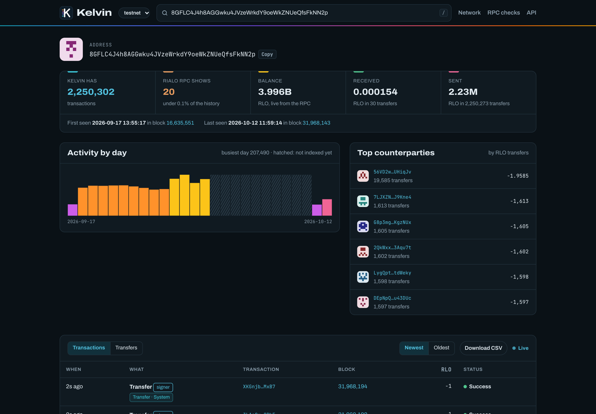
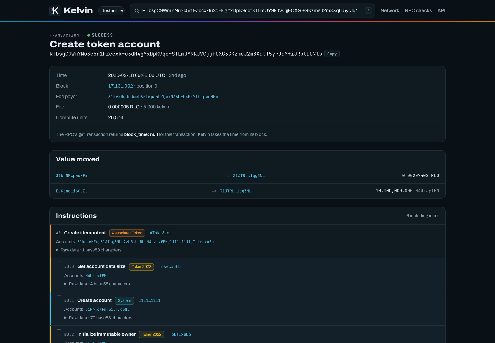

<p align="center">
  <picture>
    <source media="(prefers-color-scheme: dark)" srcset="brand/kelvin-logo-dark.png">
    
  </picture>
</p>

<p align="center">
  <a href="https://kelvinscan.pages.dev"></a>
  <a href="https://github.com/kriss39/kelvin/actions/workflows/ci.yml"></a>
  <a href="https://www.npmjs.com/package/kelvin-rialo"></a>
  <a href="https://www.npmjs.com/package/kelvin-rialo-mcp"></a>
  
</p>

<p align="center">
  <a href="https://kelvinscan.pages.dev"><b>Explorer</b></a> ·
  <a href="https://kelvinscan.pages.dev/docs"><b>API reference</b></a> ·
  <a href="sdk/typescript/README.md"><b>TypeScript SDK</b></a> ·
  <a href="sdk/mcp/README.md"><b>MCP server</b></a> ·
  <a href="docs/ARCHITECTURE.md"><b>How it works</b></a>
</p>

**Kelvin** indexes every [Rialo](https://rialo.io) block and serves the full history the RPC
cannot: every transaction of an address, pageable both ways, with block times, decoded
instructions and value movements, plus a live feed and an explorer.

Rialo's RPC answers `getSignaturesForAddress` with the newest 20 signatures and ignores `limit`
and `before`, so older history cannot be reached. Blocks older than 17 September 2026 are gone.
Kelvin keeps all of it. For the busiest testnet address that is more than 2 million transactions
where the RPC shows 20.

*1 RLO = 10⁹ kelvin, the smallest unit of Rialo's native token.*

<p align="center"></p>

## Try it

The public instance at <https://kelvinscan.pages.dev> is free to use (10 requests per second per
client).

```sh
# The oldest transactions of an address: the RPC alone cannot go further back than its newest 20.
curl "https://kelvinscan.pages.dev/v1/testnet/address/8GFLC4J4h8AGGwku4JVzeWrkdY9oeWkZNUeQfsFkNN2p/txs?order=asc&limit=3"
```

```ts
// npm install kelvin-rialo
import { Kelvin } from "kelvin-rialo";

const kelvin = new Kelvin({ baseUrl: "https://kelvinscan.pages.dev" });
// Pages are fetched as you iterate; this stops after the first ten, oldest first.
let n = 0;
for await (const tx of kelvin.address("8GFLC4J4h8AGGwku4JVzeWrkdY9oeWkZNUeQfsFkNN2p").history({ order: "asc" })) {
  console.log(tx.time, tx.signature, tx.status);
  if (++n === 10) break;
}
```

```sh
# Give an AI agent (Claude Code here) eight read-only tools over Rialo history.
claude mcp add kelvin -- npx -y kelvin-rialo-mcp
```

<table>
  <tr>
    <td width="50%"></td>
    <td width="50%"></td>
  </tr>
  <tr>
    <td>Every transaction of an address, activity by day, top counterparties, CSV export and a live feed.</td>
    <td>Decoded instructions (inner ones too), RLO and token movements, and the time the RPC leaves out.</td>
  </tr>
</table>

## What the RPC cannot do, and Kelvin does

Measured against `testnet.rialo.io` (0.21.0-alpha.0) and re-checked every hour by Kelvin itself at
`/v1/testnet/rpc-conformance`.

| Need | Rialo RPC | Kelvin |
|---|---|---|
| Address history | Newest 20 only; `limit` and `before` ignored | Every transaction, cursor paging both ways |
| Old blocks | Nothing below block 16,635,303 | Keeps every block it indexed |
| Transaction time | `getTransaction` returns `block_time: null` | `time` on every transaction |
| Time units | Seconds in `getBlock`, milliseconds in `getSignaturesForAddress` | ISO 8601 plus milliseconds everywhere |
| Balance changes | No pre/post balances in transaction meta | RLO and token movements decoded from instructions |
| Large amounts | Balances exceed 2⁵³ | Amounts as decimal strings |
| Live updates | Polling | Server-sent events, optionally for one address |

## Status

Running on testnet since October 2026, on a single 1 GB server.

- **Head follower** 2 blocks behind the chain, about 1–4 seconds of lag.
- **Backfill** from the oldest block the RPC serves (16,635,303) at 500–900 blocks/s; no missing
  blocks so far.
- **Decoding** of System, Compute Budget, Token-2022 / SPL Token, Associated Token and oracle
  instructions: 98.9% of instructions; the rest keep their raw data.
- **API** with OpenAPI docs, a live stream, CSV export and hourly RPC conformance checks.
- **TypeScript SDK** and an **MCP server** for AI agents, both on npm.
- **Explorer**: live feed, the last hour by program, address pages (daily activity, top
  counterparties, REX requests), transaction pages (workflow lineage), block and program pages,
  and a network page (validators, DKG committee, epoch).
- **Devnet** is next: its blocks carry about 90 times more oracle data than testnet's.

## Quick start

Run your own: needs Docker and Rust 1.88 or newer.

```sh
docker compose up -d db          # Postgres 16 on 127.0.0.1:54329
cp .env.example .env
cargo build --release
./target/release/kelvin run --network testnet --api 127.0.0.1:8080
```

Open <http://127.0.0.1:8080/> for the explorer and <http://127.0.0.1:8080/docs> for the API
reference. `run` applies migrations, starts the head follower and the backfill and serves the API;
stop it with Ctrl-C and it resumes from its saved cursors.

```sh
curl "http://127.0.0.1:8080/v1/testnet/address/8GFLC4J4h8AGGwku4JVzeWrkdY9oeWkZNUeQfsFkNN2p/txs?limit=2"
```

## Documentation

| | |
|---|---|
| [docs/API.md](docs/API.md) | Conventions, paging, the live stream, examples in curl and JavaScript |
| [docs/ARCHITECTURE.md](docs/ARCHITECTURE.md) | Pipeline, cursors, finality, storage design, decoding, conformance, testing |
| [docs/OPERATIONS.md](docs/OPERATIONS.md) | Commands, configuration, tests, deploying (Azure, Oracle), monitoring, maintenance |
| [sdk/typescript](sdk/typescript/README.md) | TypeScript client: typed calls, history iterators, live subscriptions. `npm install kelvin-rialo` |
| [sdk/mcp](sdk/mcp/README.md) | MCP server so AI agents can query Rialo history. `npx -y kelvin-rialo-mcp` |
| [brand/](brand/README.md) | Logo, colours and the link-preview card |
| [`src/openapi.yaml`](src/openapi.yaml) | The API specification |

## Layout

```
src/
  rpc.rs          JSON-RPC client with per-method parameter shapes and retries
  model.rs        getBlock response types
  decode.rs       program labels and instruction decoders
  normalize.rs    blocks to column vectors for batch inserts
  ingest.rs       the ordered, parallel fetch pipeline
  indexer.rs      head follower, backfill and hourly jobs
  conformance.rs  RPC behaviour checks
  redecode.rs     decode stored instructions again
  db.rs           Postgres writes and queries
  api.rs          HTTP API, live stream, explorer
  web/            the explorer page
migrations/       schema
deploy/           Docker image, compose stack, deploy and instance scripts
sdk/typescript/   TypeScript client
sdk/mcp/          MCP server for AI agents
tests/fixtures/   real testnet blocks for the normalizer tests
```

## License

Apache-2.0. See [LICENSE](LICENSE).
