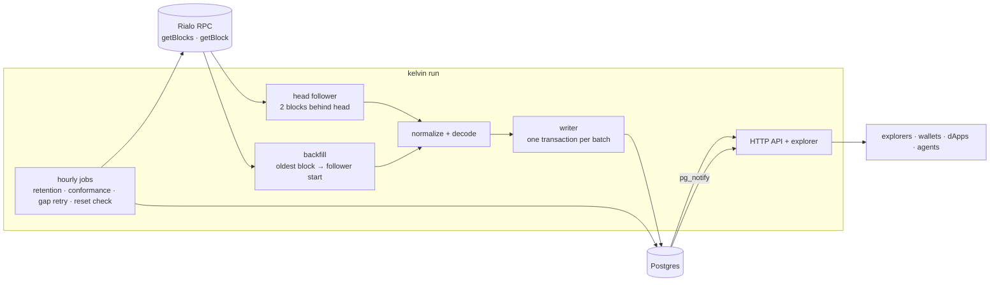

# Architecture

Kelvin is one Rust binary and one Postgres database. The binary follows the Rialo chain, fills in
the history the RPC still serves, and answers HTTP requests for that history. This document
explains how the pieces fit and why they are built the way they are.

## What the RPC gives us

Everything Kelvin stores comes from two methods:

- `getBlocks [start, end]` lists the heights that exist in a range (up to 5,001 per call).
- `getBlock {blockHeight}` returns a block with every transaction, its meta, logs and inner
  instructions.

There is no need for `getTransaction`. The RPC's own quirks are listed in the README and
re-measured hourly (see [Conformance](#conformance)).

## Ingest pipeline (`src/ingest.rs`)

One pipeline serves the backfill, the head follower and one-off ranges:

1. **List.** A span of up to 5,000 heights is listed with `getBlocks`. Heights missing from the
   list become `not_listed` records. When following the head, trailing gaps are deferred instead,
   because load-balanced nodes trail each other by a block or two.
2. **Fetch.** `getBlock` calls run concurrently (`try_buffered`, 8–48 at a time) but results are
   consumed **in height order**. A listed height that comes back "not found" is retried
   (`not_found_retries`) before it is recorded as `not_found`.
3. **Normalize.** Each block becomes column vectors in a `Batch` (see below). A block that fails
   to normalize is rolled out of the batch and recorded as `invalid: <reason>`; the run goes on.
4. **Write.** A writer task commits a batch when it holds `batch` blocks or is `flush_after` old
   (500 blocks / 5 s for the backfill, 100 / 1 s for the follower). Fetching continues while a
   batch is written.

Because results are consumed in order, every committed batch can move a **cursor** in the same
database transaction: after a crash or restart, work resumes exactly after the last committed
height, and nothing is skipped or double-counted. All inserts are `ON CONFLICT DO NOTHING`, so
re-indexing any range is harmless.

## Head follower and backfill (`src/indexer.rs`)

`kelvin run` runs both in one process:

| Task | From | Until | Cursor |
|---|---|---|---|
| Head follower | the head when it first started (`tip_from`) | never; 2 blocks behind the head | `ingest_state.tip_next` |
| Backfill | the oldest block the RPC serves (`backfill_from`) | `tip_from - 1` | `ingest_state.backfill_next` |

The follower stays only 2 blocks behind because Rialo blocks are final as soon as they are served:
79 of 79 head blocks fetched the moment they appeared were unchanged when fetched again 20 seconds
later. Lag is typically 1–4 seconds.

Each task runs under a supervisor that restarts it from its cursor 30 s after any error (RPC
outage, database restart). Ctrl-C or SIGTERM stops both after the blocks already fetched are
written.

Background jobs in the same process:

| Job | Every | What it does |
|---|---|---|
| Retention sample | 1 h | Binary-searches the oldest block the RPC serves (there is no `getFirstAvailableBlock`) and records it in `retention`. Shows whether pruning moves. |
| Conformance | 1 h | Re-runs the RPC checks into `rpc_conformance`. |
| Gap retry | 1 h | Fetches `not_found` / `not_listed` heights again; fully recovered ranges leave `missing_blocks`. |
| Reset check | 10 min | Compares the stored fingerprint of a block 1,000 below the follower with what the RPC serves now, and checks that the head has not moved backwards. A mismatch is recorded as a `reset_suspected` event. |

## Normalization (`src/normalize.rs`)

A `Batch` holds one `Vec` per table column, so the writer binds each column as a single array to
`INSERT … SELECT FROM UNNEST(…)`: one statement per table per batch, whatever the batch size.

Rules applied while normalizing:

- **System transactions** (every instruction calls `TokenomicsGovernance`, one per block) are
  counted in `blocks.sys_tx_count` and not stored.
- **Addresses** are interned per batch; the writer swaps them for ids from the `addresses`
  dictionary (see below).
- **Inner instructions** come flat from the RPC as `{instructionIndex, instruction}`; they are
  numbered within their parent (`inner_idx`), top-level ones get `inner_idx = -1`.
- **Invoked programs are not address rows.** The System program appears in nearly every
  transaction; listing it in `tx_accounts` would cost about 31% of that table. Program history is
  served from the `instructions` index instead.
- **Fingerprint.** Rialo exposes no block hash, so each block stores the first 8 bytes of SHA-256
  over its signatures. The reset check compares these.

## Decoding (`src/decode.rs`)

Instruction layouts are Solana's and were checked against testnet blocks and their program logs.

| Program | Decoded |
|---|---|
| System | All instruction kinds; RLO movements from `transfer`, `create_account`, `create_account_with_seed`, `transfer_with_seed`, `withdraw_nonce` |
| Compute Budget | All kinds |
| Token-2022 and SPL Token | Kinds 0–41; token movements with their mint from `mint_to`, `burn`, `transfer_checked` and the `*_checked` variants |
| Associated Token | `create`, `create_idempotent`, `recover_nested` |
| Oracle processor / registry | `report` / `create` (the only discriminant seen; confirmed by logs) |

Movements are only recorded for successful transactions. A mint is recorded as a transfer from
the mint account, a burn as a transfer to it. Plain token `transfer` (no mint in the instruction)
gets a kind but no movement.

Instruction data and accounts are always stored raw. When a decoder is added, `kelvin redecode`
fills in kinds and transfers from the database without fetching any block again.

## Storage (`migrations/`)

| Table | Key | Notes |
|---|---|---|
| `addresses` | `id` | Every address once, 32 bytes. Other tables store the 8-byte id. |
| `blocks` | `(network, height)` | Time, transaction counts, fingerprint |
| `txs` | `(network, height, idx)` | User transactions; unique index on `(network, signature)` |
| `tx_accounts` | `(network, address, height, idx)` | The address-history index; role 0–3 = signer/writable combinations |
| `instructions` | `(network, height, idx, ix_idx, inner_idx)` | Raw data and account indexes; index on `(network, program, height, idx)` for program history |
| `transfers` | `(network, height, idx, ix_idx, inner_idx)` | Decoded movements; indexes on source and destination |
| `logs` | `(network, height, idx)` | Program logs, newline-joined |
| `ingest_state` | `network` | The two cursors |
| `missing_blocks`, `retention`, `events`, `rpc_conformance` | | Operational records |

Columns are ordered 8-byte, 4-byte, 2-byte, then variable-length so rows carry no alignment
padding. The address dictionary cut storage by about 29%. Measured footprint: about 1.4 KB per
block at October 2026 testnet activity (about 470 B in quiet periods); the full retained window of
14.8 M blocks is about 15–21 GB.

New addresses are inserted in a short transaction of their own, in key order, before the batch
transaction. That keeps unique-index locks brief and means two concurrent writers can never wait
on each other in a cycle.

## API (`src/api.rs`)

- **Pagination** is keyset-based on `(height, idx)` (and `ix_idx, inner_idx` for transfers). The
  opaque `next_cursor` is that position; pages are stable while new blocks arrive and cost the
  same at page 1 and page 10,000.
- **Caching.** Blocks and transactions are final and served with `max-age=86400`; lists and
  status with `max-age=5`. CORS allows any origin.
- **Live stream.** Every batch the follower commits ends with `pg_notify('kelvin_tip',
  'network:first:last')`. Each API process listens, builds the update once (blocks and
  transaction summaries with their account keys) and fans it out to `/stream` subscribers over a
  broadcast channel, filtering by address per subscriber. Because the notification goes through
  Postgres, the API can run in a different process from the indexer.
- **Timeouts and limits.** Requests that take longer than 20 s get 503; streams are unaffected
  once open. The API has its own connection pool with a 15 s statement timeout, so slow queries
  never hold up the indexer. Each client gets a token bucket (10 requests per second, bursts of
  40), keyed on the address the Pages front forwards, Cloudflare's `cf-connecting-ip` or the TCP
  peer. At most 3 CSV exports stream at once.

The explorer (`src/web/index.html`) is a single static page compiled into the binary and served
at `/`. It only uses the public API.

## Conformance (`src/conformance.rs`)

Ten checks probe the RPC every hour: history capped at 20, `limit` and `before` ignored,
`block_time: null` from `getTransaction`, seconds vs milliseconds, missing balance changes,
pruning, transaction-count consistency, CORS and the version. Each result is stored with what was
observed, so `/rpc-conformance` can say since when a result has held. The first run caught a
change: the RPC now sends CORS headers, which earlier community reports said it did not.

## Testing

- Unit tests for decoders and helpers, and fixture tests that run four real testnet blocks
  (`tests/fixtures`) through the normalizer: a plain transfer, a failed transaction, an oracle
  report with inner account creation and a Token-2022 transfer through an associated token
  account.
- During development, API output for random transactions was compared field by field with the
  RPC's raw `getBlock` data (12 of 12 identical), and complete address histories were paged in
  both directions and checked for order, duplicates and count.
- An end-to-end API test (`src/api.rs`, module `integration`) writes the four fixture blocks to a
  real Postgres with the indexer's own writer, starts the HTTP server on a free port and checks
  block and transaction detail, transfer order, address paging (one transaction per page until
  the cursor runs out), CSV export, failed transactions and error codes. It runs only when
  `KELVIN_TEST_DATABASE_URL` is set, because it wipes that database.
- CI runs `cargo fmt --check`, `clippy -D warnings` and all tests, the end-to-end one against a
  Postgres service container, on every push.
